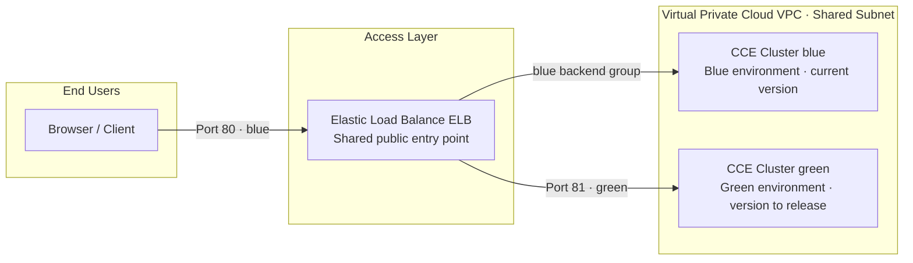

# distributed-x-infrastructure-cce-clusters-shared-subnets

[](LICENSE)
[](https://support.huaweicloud.com/intl/en-us/)
[](#)
> CCE Shared Subnets with Blue/Green Deployments

## 1. Overview

### Introduction

This practice demonstrates a container deployment architecture on Huawei Cloud designed for smooth upgrades: **two Cloud Container Engine (CCE) clusters share the same VPC and subnets, and use the same Elastic Load Balance (ELB) to serve blue/green backend sets, achieving blue/green release and upgrades without changing the entry endpoint.**

It solves the following common pain points:

- When IP address resources are scarce, there is no need to allocate a separate subnet or CIDR block for the second cluster;
- No need to change the external load balancer endpoint during blue/green switchover;
- With two independent clusters as carriers, the old and new versions are completely isolated, suitable for whole-cluster upgrade scenarios.

Targeted at DevOps / cloud-native infrastructure engineers, it can be used as a reference architecture or a learning sample.

---

## 2. Table of Contents

- [1. Overview](#1-overview)
- [2. Table of Contents](#2-table-of-contents)
- [3. Architecture Diagram](#3-architecture-diagram)
- [4. Highlights](#4-highlights)
- [5. Cloud Services Used](#5-cloud-services-used)
- [6. Prerequisites](#6-prerequisites)
- [7. Quick Start](#7-quick-start)
- [8. Step-by-Step Deployment](#8-step-by-step-deployment)
- [9. Usage / Verification](#9-usage--verification)
- [10. Cleanup](#10-cleanup)
- [11. Detailed Explanation](#11-detailed-explanation)
- [12. Dependencies](#12-dependencies)
- [13. FAQ / Troubleshooting](#13-faq--troubleshooting)
- [14. Contributing](#14-contributing)
- [15. License](#15-license)
- [16. Contact / Maintainers](#16-contact--maintainers)

---

## 3. Architecture Diagram



**Key Components**:

- **Virtual Private Cloud (VPC)**: Hosts all resources, shared by both clusters.
- **Shared subnet**: The node subnet is reused by both clusters and both node pools.
- **Cloud Container Engine (CCE)**: Two independent Kubernetes clusters (blue/green), with node pools providing nodes on demand.
- **Elastic Load Balance (ELB)**: A single public entry point with blue/green backends attached separately.

---

## 4. Highlights

- **Shared subnets**: Both clusters reuse the same set of subnets, simplifying IP planning and avoiding a separate CIDR block per cluster.
- **Single entry point**: One shared ELB carries both blue and green backend sets, so the entry address stays unchanged during upgrades.
- **Whole-cluster blue/green**: With two independent clusters as carriers, the old and new versions are completely isolated, allowing clean switchover and rollback.
- **One-click IaC delivery**: Terraform declares all infrastructure and manifest files declare the applications, making the deployment reproducible and auditable.

---

## 5. Cloud Services Used

| Service | Purpose |
|---|---|
| Virtual Private Cloud (VPC) | Hosts the network and subnets |
| Cloud Container Engine (CCE) | Two Kubernetes clusters and session node pools |
| Elastic Load Balance (ELB) | Single public entry point and blue/green backends |
| Elastic IP (EIP) | Public entry for ELB and the control plane |

> All services can be created with one command through the Terraform configuration in this repository; to release resources, see [Section 10](#10-cleanup).

---

## 6. Prerequisites

| Item | Requirement |
|---|---|
| Account | A Huawei Cloud account opened with real-name verification completed |
| Permissions | IAM administrator permissions or equivalent (able to create VPC / CCE / ELB / EIP) |
| Terraform | >= 1.5.0 |
| kubectl | >= 1.28 |
| Credentials | Obtain the Access Key ID and Secret Access Key on the Huawei Cloud "My Credentials" page |

---

## 7. Quick Start

```bash
# 1. Prepare Huawei Cloud credentials
export HW_ACCESS_KEY="<your-access-key>"
export HW_SECRET_KEY="<your-secret-key>"

# 2. Initialize and deploy
cd infra
terraform init
terraform plan
terraform apply -auto-approve

# 3. View key outputs (shared ELB ID / cluster names / control plane IP)
terraform output
```

> For the full step-by-step procedure and expected outputs, see [Section 8](#8-step-by-step-deployment).

---

## 8. Step-by-Step Deployment

### Step 1: Initialize

```bash
cd infra
terraform init
```

**Expected output**: `Terraform has been successfully initialized!`

### Step 2: Preview

```bash
terraform plan
```

**Expected output**: `Plan: N to add, 0 to change, 0 to destroy.`

### Step 3: Apply the Deployment

```bash
terraform apply -auto-approve
```

**Expected output**: `Apply complete! Resources: N added, 0 changed, 0 destroyed.`

### Step 4: Deploy the Blue/Green Applications

```bash
ELB_ID=$(terraform output -raw shared_elb_id)
sed -i "s/<ELB_ID>/${ELB_ID}/" manifests/blue/service.yaml manifests/green/service.yaml

kubectl --kubeconfig <blue-kubeconfig> apply -f manifests/namespace.yaml
kubectl --kubeconfig <blue-kubeconfig> apply -f manifests/blue/
kubectl --kubeconfig <green-kubeconfig> apply -f manifests/namespace.yaml
kubectl --kubeconfig <green-kubeconfig> apply -f manifests/green/
```

---

## 9. Usage / Verification

After deployment, follow the steps below to verify that the business functionality works.

### Verification 1: Pods Are Ready

```bash
kubectl --kubeconfig <blue-kubeconfig> get pods -n blue-green
kubectl --kubeconfig <green-kubeconfig> get pods -n blue-green
```

**Expected output**: The `blue-green-app` Pods in both blue and green clusters are `Running` (2 replicas each).

### Verification 2: Blue Environment Is Accessible

```bash
curl http://<shared_elb_public_ip>:80
```

**Expected output**:

```
blue
```

### Verification 3: Green Environment Is Accessible

```bash
curl http://<shared_elb_public_ip>:81
```

**Expected output**:

```
green
```

### Verification 4: Blue/Green Switchover (Recommended)

After changing the external domain name/route from `:80` to `:81`, access the same domain name again; it should return `green`, and the entry address remains unchanged, proving that the blue/green switchover completed without changing the endpoint.

> After deployment, follow these steps to verify that the business functionality works before considering the delivery complete.

---

## 10. Cleanup

```bash
cd infra
terraform destroy -auto-approve
```

**Expected output**: `Destroy complete! Resources: N destroyed.`

> `terraform destroy` only releases resources tracked by Terraform; manually downloaded kubeconfig files or manually created objects must also be cleaned up to avoid leftovers.

---

## 11. Detailed Explanation

### Workflow

1. Terraform creates the VPC, shared subnets, security groups, shared ELB (with EIP), and two CCE clusters with node pools.
2. The blue and green application manifests (`manifests/blue/` and `manifests/green/`) are deployed to the two clusters with `kubectl` respectively; the LoadBalancer Service of each cluster reuses the same shared ELB via the `kubernetes.io/elb.id` annotation, and the CCE controller automatically registers backends on the ELB.
3. The blue environment listens on port 80 and the green environment on port 81; blue/green switchover means switching the external entry between the two ports (or two backends).

### Configuration Items

| Variable | Default Value | Description |
|---|---|---|
| `region` | `cn-north-4` | Huawei Cloud region |
| `project_name` | `cce-shared-subnets` | Resource naming prefix |
| `vpc_cidr` | `10.0.0.0/16` | VPC CIDR block |
| `node_flavor` | `s6.large.2` | CCE node flavor |
| `node_count` | `1` | Initial number of nodes per cluster |
| `elb_bandwidth` | `5` | Public bandwidth of the shared ELB (Mbit/s) |

---

## 12. Dependencies

| Name | Version | Purpose |
|---|---|---|
| Terraform | >= 1.5.0 | IaC orchestration |
| huaweicloud Provider | ~> 1.94 | Huawei Cloud resources |
| kubectl | >= 1.28 | Cluster application release |
| hashicorp/http-echo (container image) | latest | Blue/green demo application image |

---

## 13. FAQ / Troubleshooting

**Q1: `terraform apply` reports insufficient permissions?**

Confirm that the account has IAM administrator permissions, or at least sub-permissions including VPC Administrator, CCE Administrator, and ELB Administrator.

**Q2: The node pool keeps failing to be created?**

Check whether `node_flavor` is available in the target region and AZ, and whether the target region supports the selected flavor; if necessary, adjust `node_flavor` and `elb_az`.

**Q3: The Service does not get a public IP for a long time?**

Confirm that `kubernetes.io/elb.id` has been replaced with the real value from `terraform output -raw shared_elb_id`, and that the shared ELB has an EIP bound.

| Symptom | Possible Cause | How to Check |
|---|---|---|
| Pods are in `ImagePullBackOff` | The demo image failed to be pulled | Confirm that cluster nodes can reach the image source, or sync the image to a container registry as needed |
| Service has no `LOAD-BALANCER` IP | The ELB ID in the annotation was not replaced | Re-run `sed` replacement and `kubectl apply` |
| Node is `NotReady` | The node is not ready | Use `kubectl describe node` to check status and events |

---

## 14. Contributing

Issues and PRs are welcome:

1. **Issue**: Describe the problem or suggestion (with reproduction commands, expected/actual output, and screenshots).
2. **PR**: Create a feature branch from `main`; before committing, run `terraform validate` and `terraform fmt -check`.

---

## 15. License

This practice is released under the **MIT No Attribution** license. See the [`LICENSE`](LICENSE) file in the repository root for details.

```
MIT No Attribution

Copyright (c) Huawei Cloud

Permission is hereby granted, free of charge, to any person obtaining a copy
of this software... (no attribution required)
```

---

## 16. Contact / Maintainers
| Item | Content |
|---|---|
| **Creator** | [dgc-git](https://github.com/dgc-git) |
| **Maintainer** | [dgc-git](https://github.com/dgc-git) |
| **Contact** | GitHub Issues / PR (see [Section 14](#14-contributing)) |
