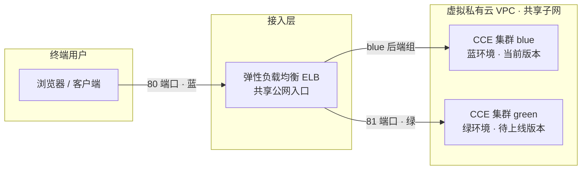

# distributed-x-infrastructure-cce-clusters-shared-subnets

[](LICENSE)
[](https://support.huaweicloud.com/intl/en-us/)
[](#)
> 云容器共享子网蓝绿发布（CCE Shared Subnets with Blue/Green Deployments）

## 1. 简介 / Overview

### 简介


本实践演示一种在华为云上运行、面向平滑升级的容器部署架构：**让两个云容器引擎（CCE）集群共享同一套 VPC 与子网，并借由同一个弹性负载均衡（ELB）对外提供蓝/绿两套后端，实现不改变入口端点的蓝绿发布与升级。**

它解决以下常见痛点：

- IP 地址资源紧张时，不必为第二个集群单独划分子网或网段；
- 蓝绿切换时不必变更外部负载均衡端点；
- 以两个独立集群为载体，新旧版本完全隔离，适合整集群升级场景。

面向 DevOps / 云原生基础设施工程师，可作为参考架构或学习样例使用。

---

## 2. 目录

- [1. 简介 / Overview](#1-简介--overview)
- [2. 目录](#2-目录)
- [3. 架构图](#3-架构图)
- [4. 方案亮点](#4-方案亮点)
- [5. 涉及云服务](#5-涉及云服务)
- [6. 前置条件](#6-前置条件)
- [7. 快速开始](#7-快速开始)
- [8. 分步部署](#8-分步部署)
- [9. 使用方法 / 验证](#9-使用方法--验证)
- [10. 清理资源](#10-清理资源)
- [11. 详细说明](#11-详细说明)
- [12. 依赖](#12-依赖)
- [13. FAQ / 故障排除](#13-faq--故障排除)
- [14. 贡献指南](#14-贡献指南)
- [15. 许可证](#15-许可证)
- [16. 联系方式 / 维护者](#16-联系方式--维护者)

---

## 3. 架构图



**关键组件**：

- **虚拟私有云（VPC）**：承载全部资源，两个集群共用。
- **共享子网**：节点子网被两个集群与两个节点池复用。
- **云容器引擎（CCE）**：两个独立 Kubernetes 集群（蓝/绿），节点池按需提供节点。
- **弹性负载均衡（ELB）**：单一公网入口，蓝/绿后端分别挂载。

---

## 4. 方案亮点

- **共享子网**：两个集群复用同一组子网，简化 IP 规划，避免为每个集群划独立网段。
- **单一入口**：一个共享 ELB 承载蓝/绿两套后端，升级时入口地址保持不变。
- **整集群蓝绿**：以两个独立集群为载体，新旧版本完全隔离，切换干净、可回退。
- **IaC 一键交付**：Terraform 声明全部基础设施，清单文件声明应用，可复现、可审计。

---

## 5. 涉及云服务

| 服务 | 用途 |
|---|---|
| 虚拟私有云 VPC | 承载网络与子网 |
| 云容器引擎 CCE | 两个 Kubernetes 集群与会话节点池 |
| 弹性负载均衡 ELB | 单一公网入口与蓝绿后端 |
| 弹性公网 IP EIP | ELB 与控制面公网入口 |

> 所有服务均可通过本仓库 Terraform 一键创建；如需释放资源，见 [第 10 节](#10-清理资源)。

---

## 6. 前置条件

| 项 | 要求 |
|---|---|
| 账号 | 已开通华为云账号并完成实名认证 |
| 权限 | IAM 管理员权限或等效（可创建 VPC / CCE / ELB / EIP） |
| Terraform | >= 1.5.0 |
| kubectl | >= 1.28 |
| 凭据 | 在华为云「我的凭证」页面获取 Access Key ID 与 Secret Access Key |

---

## 7. 快速开始

```bash
# 1. 准备华为云凭据
export HW_ACCESS_KEY="<your-access-key>"
export HW_SECRET_KEY="<your-secret-key>"

# 2. 初始化与部署
cd infra
terraform init
terraform plan
terraform apply -auto-approve

# 3. 查看关键输出（共享 ELB ID / 集群名称 / 控制面 IP）
terraform output
```

> 完整分步步骤与预期输出见 [第 8 节](#8-分步部署)。

---

## 8. 分步部署

### 步骤 1：初始化

```bash
cd infra
terraform init
```

**预期输出**：`Terraform has been successfully initialized!`

### 步骤 2：预演

```bash
terraform plan
```

**预期输出**：`Plan: N to add, 0 to change, 0 to destroy.`

### 步骤 3：执行部署

```bash
terraform apply -auto-approve
```

**预期输出**：`Apply complete! Resources: N added, 0 changed, 0 destroyed.`

### 步骤 4：部署蓝绿应用

```bash
ELB_ID=$(terraform output -raw shared_elb_id)
sed -i "s/<ELB_ID>/${ELB_ID}/" manifests/blue/service.yaml manifests/green/service.yaml

kubectl --kubeconfig <blue-kubeconfig> apply -f manifests/namespace.yaml
kubectl --kubeconfig <blue-kubeconfig> apply -f manifests/blue/
kubectl --kubeconfig <green-kubeconfig> apply -f manifests/namespace.yaml
kubectl --kubeconfig <green-kubeconfig> apply -f manifests/green/
```

---

## 9. 使用方法 / 验证

部署完成后，请按以下步骤验证业务功能可用。

### 验证 1：Pod 就绪

```bash
kubectl --kubeconfig <blue-kubeconfig> get pods -n blue-green
kubectl --kubeconfig <green-kubeconfig> get pods -n blue-green
```

**预期输出**：蓝/绿两个集群的 `blue-green-app` Pod 均为 `Running`（各 2 个副本）。

### 验证 2：蓝环境可访问

```bash
curl http://<shared_elb_public_ip>:80
```

**预期输出**：

```
blue
```

### 验证 3：绿环境可访问

```bash
curl http://<shared_elb_public_ip>:81
```

**预期输出**：

```
green
```

### 验证 4：蓝绿切换（推荐）

将外部域名/路由从 `:80` 改指向 `:81` 后，再次访问同一域名，应返回 `green`，且入口地址保持不变，证明蓝绿切换在不改端点下完成。

> **提示**：请在部署完成后按本节逐步验证，确认业务功能可用，方可视为交付完成。

---

## 10. 清理资源

```bash
cd infra
terraform destroy -auto-approve
```

**预期输出**：`Destroy complete! Resources: N destroyed.`

> `terraform destroy` 仅释放 Terraform 追踪的资源；手工下载的 kubeconfig 或手工创建的对象需一并清理，避免残留。

---

## 11. 详细说明

### 工作流程

1. Terraform 创建 VPC、共享子网、安全组、共享 ELB（含 EIP）以及两个 CCE 集群与节点池。
2. 蓝、绿两套应用清单（`manifests/blue/` 与 `manifests/green/`）分别用 `kubectl` 部署到两个集群；每个集群的 LoadBalancer Service 通过 `kubernetes.io/elb.id` 注解复用同一个共享 ELB，由 CCE 控制器自动在 ELB 上注册后端。
3. 蓝环境监听 80 端口、绿环境监听 81 端口；蓝绿切换即把外部入口在两端口（或两后端）间切换。

### 配置项

| 变量 | 默认值 | 说明 |
|---|---|---|
| `region` | `cn-north-4` | 华为云区域 |
| `project_name` | `cce-shared-subnets` | 资源命名前缀 |
| `vpc_cidr` | `10.0.0.0/16` | VPC 网段 |
| `node_flavor` | `s6.large.2` | CCE 节点规格 |
| `node_count` | `1` | 每个集群初始节点数 |
| `elb_bandwidth` | `5` | 共享 ELB 公网带宽（Mbit/s） |

---

## 12. 依赖

| 名称 | 版本 | 用途 |
|---|---|---|
| Terraform | >= 1.5.0 | IaC 编排 |
| huaweicloud Provider | ~> 1.94 | 华为云资源 |
| kubectl | >= 1.28 | 集群应用发布 |
| hashicorp/http-echo（容器镜像） | latest | 蓝绿演示应用镜像 |

---

## 13. FAQ / 故障排除

**Q1：`terraform apply` 提示权限不足？**

确认账号具备 IAM 管理员权限，或至少包含 VPC Administrator、CCE Administrator、ELB Administrator 等子权限。

**Q2：节点池一直创建失败？**

核对 `node_flavor` 在目标区域与可用区是否可用，以及目标区域是否支持所选规格；必要时调整 `node_flavor` 与 `elb_az`。

**Q3：Service 长时间拿不到公网 IP？**

确认 `kubernetes.io/elb.id` 已替换为 `terraform output -raw shared_elb_id` 的真实值，且共享 ELB 已绑定 EIP。

| 现象 | 可能原因 | 排查方法 |
|---|---|---|
| Pod 处于 `ImagePullBackOff` | 演示镜像拉取失败 | 确认集群节点可访问镜像源，或按需将镜像同步至容器镜像仓库 |
| Service 无 `LOAD-BALANCER` IP | 注解中的 ELB ID 未替换 | 重新 `sed` 替换并 `kubectl apply` |
| 节点 `NotReady` | 节点未就绪 | `kubectl describe node` 查看状态与事件 |

---

## 14. 贡献指南

欢迎提交 Issue 与 PR：

1. **Issue**：描述问题或建议（含复现命令、预期/实际输出、截图）。
2. **PR**：基于 `main` 分支新建 feature 分支；提交前运行 `terraform validate` 与 `terraform fmt -check`。

---

## 15. 许可证

本实践采用 **MIT No Attribution** 许可证发布。详见仓库根目录 [`LICENSE`](LICENSE) 文件。

```
MIT No Attribution

Copyright (c) Huawei Cloud

Permission is hereby granted, free of charge, to any person obtaining a copy
of this software... (no attribution required)
```

---

## 16. 联系方式 / 维护者
| 项 | 内容 |
|---|---|
| **创建者** | [dgc-git](https://github.com/dgc-git) |
| **维护者** | [dgc-git](https://github.com/dgc-git) |
| **联系方式** | GitHub Issues / PR（见[第 14 节](#14-贡献指南)） |
