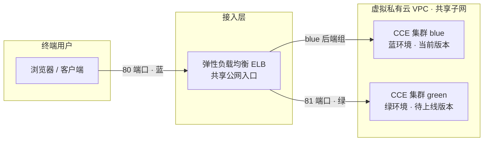

# 架构说明

本实践演示一种在华为云上运行的容器部署架构：**让两个云容器引擎（CCE）集群共享同一套 VPC 与子网，并借由同一个弹性负载均衡（ELB）对外提供蓝/绿两套后端，实现不改变入口端点的蓝绿发布与升级。**

它面向需要在多个 Kubernetes 集群之间做平滑升级、又希望在 IP 地址紧张时不必为每个集群单独划分子网或网段的团队。

## 架构总览

- **蓝/绿两个独立 CCE 集群**共享同一个 VPC 与同一组子网；每个集群拥有独立控制面。
- **单个共享 ELB** 作为统一公网入口，蓝环境监听 80 端口、绿环境监听 81 端口。
- 升级时先在绿集群验证新版本，再把入口流量从蓝切到绿，入口地址保持不变。

## 关键组件

| 组件 | 职责 |
|---|---|
| 虚拟私有云（VPC） | 承载全部资源；两个集群共用同一网段 |
| 子网 | 节点子网被两个集群与两个节点池共享 |
| 云容器引擎（CCE） | 承载两个独立 Kubernetes 集群（蓝/绿），节点池按需提供节点 |
| 弹性负载均衡（ELB） | 单一公网入口，蓝/绿后端分别挂载，切换时入口不变 |
| 弹性公网 IP（EIP） | 为 ELB 与控制面提供公网入口 |

## 蓝绿切换流程

1. 应用以 `blue` 与 `green` 两个变体分别部署到两个集群。
2. 默认（蓝）集群承载线上流量。
3. 升级发布时，先在绿集群完成部署与验证。
4. 将入口流量从蓝端口切到绿端口（或调整外部域名/路由指向），完成切换。

> 本实践的「蓝绿」以两个独立集群为载体（区别于同集群内的金丝雀发布），适用于需要整集群升级、或希望新旧版本完全隔离的场景。